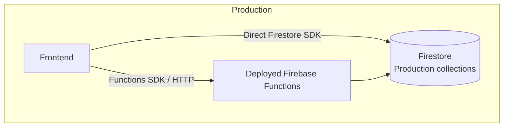
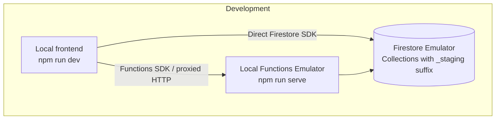

# Development Guide

## TL;DR

1. Root `.env.local`:

   ```
   VITE_USE_FIREBASE_EMULATORS=true
   VITE_ENVIRONMENT=development
   ```

2. `functions/.env.local` (copy `functions/.env.example`):

   ```
   ENVIRONMENT=development
   ```

3. Run both:

   ```bash
   npm run dev
   ```

   ```bash
   cd ./functions
   npm run serve
   ```

This runs the Functions and Firestore emulators, so nothing touches the
real database. You might also need a `functions/.secret.local` file for the
functions secrets (see below).

## Where the env variables go (read this before deploying)

| File                   | Read by                     | Deployed?                  |
| ---------------------- | --------------------------- | -------------------------- |
| `.env` / `.env.local`  | Vite                        | Baked into `npm run build` |
| `functions/.env`       | Emulator and deployed funcs | **Yes**, with the code     |
| `functions/.env.local` | Functions emulator only     | No (`*.local` is ignored)  |

- Put `ENVIRONMENT=development` in `functions/.env.local`, never in
  `functions/.env`. The Firebase CLI uploads `functions/.env` on every
  deploy.
- Both switches are guarded in code as a second line of defense:
  `functions/src/lib/environment.ts` only honours `ENVIRONMENT` under the
  emulator (`FUNCTIONS_EMULATOR=true`), and `src/lib/environment.ts` only
  honours `VITE_ENVIRONMENT` on the dev server (`import.meta.env.DEV`). A
  production build or deploy always runs in production mode.

## How it works

The frontend reads and writes data three ways:

- Directly through the Firestore SDK (only `featureFlags/registration`)
- Through the Functions SDK (callables)
- Through `/api/admin/*`, an HTTP function behind a Hosting rewrite

In development mode (`VITE_ENVIRONMENT=development` on the frontend,
`ENVIRONMENT=development` in the emulator):

- Every collection name gets a `_staging` suffix (`featureFlags_staging`,
  `workshopSignups_staging`, ...). The suffix lives in
  `src/lib/environment.ts` and `functions/src/lib/environment.ts`; keep
  them in sync.
- `requestVerificationCode` logs the code to the emulator terminal
  instead of emailing it.
- `npm run dev` proxies `/api/admin/*` to the Functions emulator (see
  `vite.config.ts`), the same way the Hosting rewrite does in production,
  so the admin panel works without CORS.

### Data isolation

With the default setup (`npm run serve` starts the Functions **and**
Firestore emulators) all data stays in the local emulator. The emulator
starts empty: create `featureFlags_staging/registration` in the Emulator UI
(<http://127.0.0.1:4000/firestore>) with `workshopsRegistrationOpen` and
`competitionRegistrationOpen` set to `true`, or registration shows as
closed.

### Using the real Firestore (not isolated)

If you need real data, run only the Functions emulator and point the
frontend at the real Firestore:

```
# root .env.local
VITE_USE_FIRESTORE_EMULATOR=false
```

```bash
cd ./functions
npm run build && firebase emulators:start --only functions
```

**This writes to the production `quantumjam` database.** The `_staging`
suffix only keeps your documents out of the production collections; it is
not a separate environment. The Admin SDK uses your local Google
credentials, which usually have full access to the project. Clean up after
yourself.

Reading `featureFlags_staging` from the browser needs the rule in
`firestore.rules`, which must be deployed
(`firebase deploy --only firestore:rules`).

## Secrets

Some functions depend on secrets. Configure them in
`functions/.secret.local`:

```
QUANTUMJAM_ADMIN_USERNAME=admin
QUANTUMJAM_ADMIN_PASSWORD=<any local password>
GMAIL_APP_PASSWORD=<unused locally>
```

### Production vs. Development




