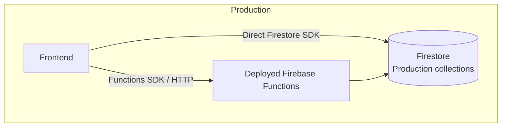
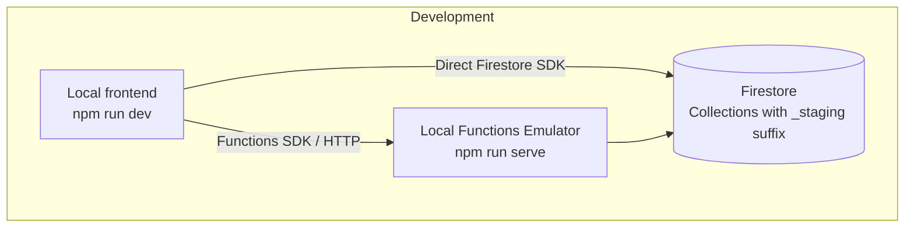

# Development Guide

## TL;DR

To run with emulated functions and hit '_staging' db's run:

```bash
npm run dev
```

and

```bash
cd ./functions
npm run serve
```

while having both root .env variables set as 'VITE_ENVIRONMENT=development' and 'VITE_USE_FIREBASE_EMULATORS=true' and functions .env variable set as 'ENVIRONMENT=development' as well. Might also have to configure .secret.local file for the required functions secrets.

## Intro

The following document explains the proposed development environment and instructions on how to run it.

## How to run

Firstly, configure local .env files.
Two have to exist, the first one on the application's root directory and the second on functions directory (see .env.example files).

On the first .env file it is required to have the following variables set as shown:

```
VITE_USE_FIREBASE_EMULATORS=true
VITE_ENVIRONMENT=development
```

On the second one:

```
ENVIRONMENT=development
```

Having these files set, proceed to execute the following commands to start running:

```bash
npm run dev
```

```bash
cd ./functions
npm run serve
```

Some functions depend on secrets, therefore you might need to also configure the .secret.local file on the functions directory.
It should look as follows:

```
QUANTUMJAM_ADMIN_USERNAME=admin
QUANTUMJAM_ADMIN_PASSWORD=contraseña123
GMAIL_APP_PASSWORD=noseusa
```

## How it works

Currently, the frontend saves/queries data one of three ways:

- Directly through firestore's SDK
- Through firebase function's SDK
- Through an endpoint wired to a function

All three approaches interact with Firestore collections or individual documents.

The goal of emulating these interactions was to have an environment similar to that of production where to test safely new features. This meant having separate compute and storage. This was achieved through emulating the functions locally and hitting different collections to those of production (distinguished by the "_staging" suffix).

Furthermore, some changes to logic had to be applied so as to make certain features work best for a development environment. The endpoint was changed so as to refer to localhost and the verification codes are logged (can be seen on the function's emulator terminal) instead of sent via email.

### Production vs. Development




